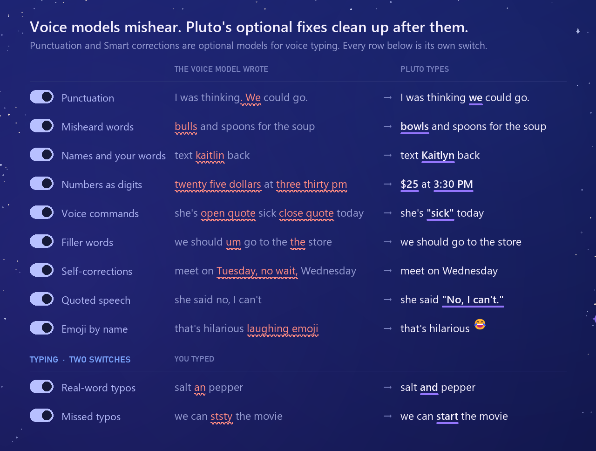
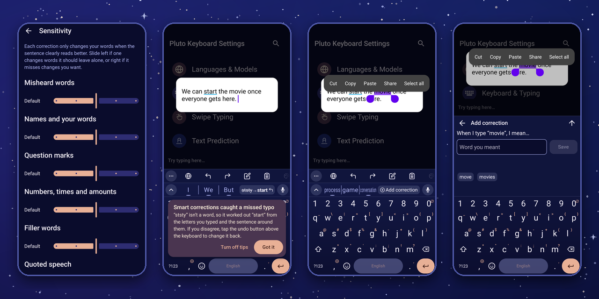

<b><a href="https://github.com/ColinCPittman/Pluto-Keyboard/releases/latest">Download the APK</a></b> &nbsp;·&nbsp; <a href="#install">Install with Obtainium</a> &nbsp;·&nbsp; Android 7+ &nbsp;·&nbsp; no internet permission &nbsp;·&nbsp; built on <a href="https://keyboard.futo.tech/">FUTO Keyboard</a>

Pluto Keyboard is a private, offline keyboard for Android with voice typing that works without sending a single word to the cloud. It learns how you type, shows your words as you speak them, and tidies up the transcript afterwards. It is built on top of [FUTO Keyboard](https://keyboard.futo.tech/), and the app has no internet permission at all, so Android won't let it connect to the internet.

I made Pluto to address a few issues I had with FUTO Keyboard.

- I wanted a keyboard that learns my taps and builds a **typing heatmap** for correcting accidentally typing the wrong letters, when typing fast, I kept hitting letters next to the ones I meant. I liked this feature from SwiftKey and missed it when I switched to FUTO, so Pluto keyboard now has a version of that. 

- I also found that FUTO’s Whisper models often missed the technical words I use for work. A larger Whisper distillation understood niche words better, but it came with a processing delay after longer recordings that quickly became tiresome. I knew that streaming models like Moonshine could address this, but FUTO didn’t support them, so now Pluto **supports Moonshine**.

As I kept using Pluto with Moonshine, I found that it had drawbacks of its own, such as its tendency to add punctuation whenever you pause too long during dictation. This often turned the output into a series of sentence fragments. After much iterating, the **punctuation fix** and **Smart Corrections** were the result. They address those drawbacks, and Smart Corrections adds features such as voice commands and emoji recognition. That foundation let me expand Smart Corrections to typing as well. All of it is modular and customizable.

## Voice and Typing Features

Words appear while you speak, for as long as you speak, with nothing sent anywhere. Moonshine enables more efficient, responsive, and adaptable voice input. The optional punctuation and Smart corrections models enable Pluto to do a second pass to improve dictation errors. Each extra, from voice commands to emoji by name, has its own toggle, its own editable list, and there are sensitivity sliders for them all. If enabled, at most it only swaps in words that sound alike or drop words that you don't want to be captured, it never rephrases you. You can also hold the mic button and talk, then let go to finish, like a walkie-talkie.

For now, Moonshine and the punctuation and Smart corrections features work in English only (Moonshine only understands English). Other languages still get voice typing through FUTO's Whisper models.

Smart corrections also works when you type. Once you finish a sentence, it rereads it and fixes the typos that slipped past the usual autocorrect. It **catches typos that are real words**, like "salt an pepper", **and missed typos**, which are misspellings that got through anyway. For those, it works out the word you meant from the letters you typed and the words around them.

Each fix shows up as a small button in the suggestion bar above the keyboard, and tapping it changes the word back. Undoing a fix teaches it to be more careful in that context, and fixing a missed typo yourself makes it more confident, so it adapts to how you write over time. You can also highlight a word you often mistype and teach it the word you meant. It has the same switches and sliders as the voice features.

Underneath all of this, the **typing heatmap** learns where your thumbs actually land and quietly adjusts the keys to meet them. If you swipe, **adaptive swipe learning** does the same for your swipes. When you keep a swipe or fix one it got wrong, it compares where your swipe started, ended and turned against the keys of the word you meant, and if the path is a believable match for that word, it learns how far off you tend to be and nudges your next swipes to match.

For a full guide to every feature, how it works and how to get the most out of it, see [docs/FEATURES.md](docs/FEATURES.md).

## Install

| | |
|:-:|---|
| **1** | **Get the app.** In [Obtainium](https://github.com/ImranR98/Obtainium), *Add App* → `https://github.com/ColinCPittman/Pluto-Keyboard`. Or download the `.apk` from the [latest release](https://github.com/ColinCPittman/Pluto-Keyboard/releases/latest). Android 7+, 64-bit. It installs next to FUTO Keyboard. |
| **2** | **Switch keyboards.** Open Pluto and follow the setup. If you're coming from FUTO you can export your configuration there and import it here. |
| **3** | **Add voice.** From the same release, download `pluto-voice-moonshine-small-en.zip`, plus `pluto-punctuation-en.zip` and `pluto-smart-corrections-en.zip` for the cleanup. Import them (don't unzip) under **Languages & Models**, which also links to the downloads. The first time you open the settings, a short tutorial walks you through it (you can skip it). [All models](docs/MODELS.md)|

## Privacy

- Pluto has **no internet permission**. Android itself blocks it from connecting to anything.
- Everything is stored on your phone (your settings, the words it learns, your personal dictionary, and any model files you import).
- The adaptive typing heatmap saves only per-key statistics (roughly "taps on the letter E tend to land a bit to the left"), never the words you type. You can view it or reset it in settings.
- Adaptive swipe learning saves the same kind of per-key numbers for your swipes, never words or swipe paths.
- Voice input is processed on your phone. The voice and correction models are only loaded when you use voice input and are unloaded again within a few minutes.
- Pluto is not available in an app store, so there is no store account involved either.

## Report a problem or suggest a feature

Pluto is a personal project that I built for myself and am sharing in case it's useful to others. I'm happy with it, but it hasn't been widely tested yet, so you may run into rough edges. If you find a bug or have an idea, please open an issue on GitHub at <https://github.com/ColinCPittman/Pluto-Keyboard/issues>. I'll do my best to address it.

The issue form will ask for the following, and it all helps a lot.

- Your phone model and Android version.
- The Pluto Keyboard version (shown in the app's settings).
- What happened, what you expected, and the steps to make it happen again.
- Which features you have on (which voice model, punctuation fix, Smart corrections, adaptive typing heatmap, adaptive swipe learning).

Please do not include passwords or private text in screenshots or recordings.

## Credits and license

Pluto Keyboard is a modified version of [FUTO Keyboard](https://github.com/futo-org/android-keyboard) by FUTO, which in turn is built on [LatinIME, the Android Open Source Project keyboard](https://android.googlesource.com/platform/packages/inputmethods/LatinIME). Nearly all of what you see in Pluto is FUTO's work, and I am grateful to them for releasing it where people can build on it.

**Modification notice.** This is a modified copy of FUTO Keyboard, made by Colin Pittman for non-commercial use. My changes include the Moonshine streaming voice engine, the punctuation and Smart corrections steps for voice input (with voice commands, emoji by name and the other extras above), Smart corrections for typing, the adaptive typing heatmap and adaptive swipe learning, the "Always use middle suggestion" and "Correct words before punctuation" options, hold-to-talk on the mic button, the setup tutorial and feature tips, the personal dictionary and password-protection changes, and the Pluto name, icon and package ID (`io.github.colincpittman.plutokeyboard`). Pluto is **not affiliated with or endorsed by FUTO**, and if something is broken in Pluto, please report it here and not to FUTO.

**License.** The code is under the [FUTO Source First License 1.1](LICENSE.md). In plain terms, you can use it for anything, and you can modify and share it for non-commercial purposes, free of charge, as long as you keep the notices. FUTO's payment option has been left in the app, as the license requires. It supports FUTO, not me, and if you enjoy this keyboard I would encourage you to support them. The original AOSP notices are in [NOTICE](NOTICE).

**Third-party pieces** (full notices in [THIRD_PARTY_NOTICES.md](THIRD_PARTY_NOTICES.md))

- [Moonshine](https://github.com/moonshine-ai/moonshine) speech recognition (MIT) and Silero VAD (MIT)
- [ONNX Runtime](https://github.com/microsoft/onnxruntime) (MIT)
- [llama.cpp](https://github.com/ggml-org/llama.cpp) (MIT) and [Qwen3](https://huggingface.co/Qwen/Qwen3-0.6B) (Apache-2.0), used for Smart corrections
- Punctuation model [pcs_en](https://huggingface.co/1-800-BAD-CODE/punctuation_fullstop_truecase_english) (Apache-2.0)
- The Smart corrections sound-alike list, derived from CMUdict (BSD-style), wordfreq data (CC BY-SA 4.0) and capitalization from the AOSP English word list (Apache-2.0)
- Emoji names for "thumbs up emoji", from the official names, aliases and tags in the [gemoji](https://github.com/github/gemoji) list FUTO Keyboard already ships (MIT), which uses the [Unicode CLDR](https://cldr.unicode.org/) emoji names (Unicode License v3)

## Building from source

If you would like to build Pluto yourself, see [docs/BUILDING.md](docs/BUILDING.md). To make your own voice, punctuation or Smart corrections model packages, see [docs/MODELS.md](docs/MODELS.md). What changed in each version is on the [releases page](https://github.com/ColinCPittman/Pluto-Keyboard/releases).
